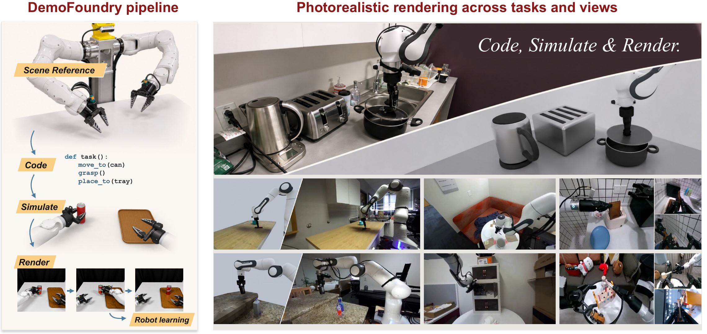
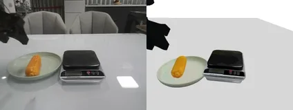
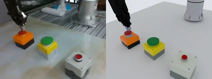
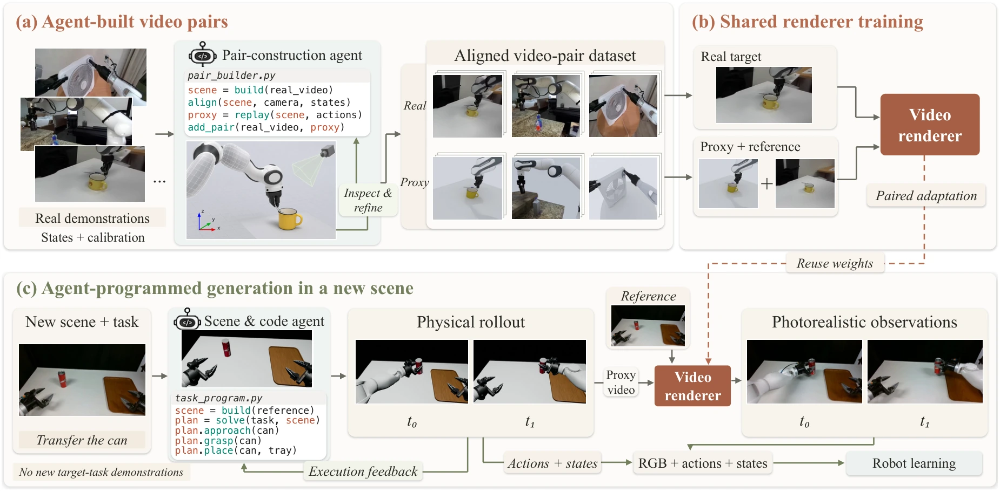
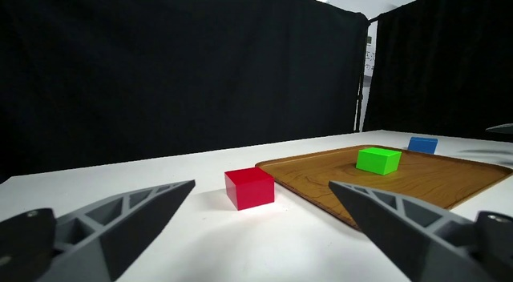
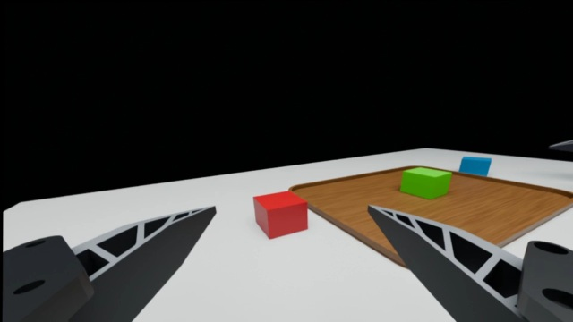
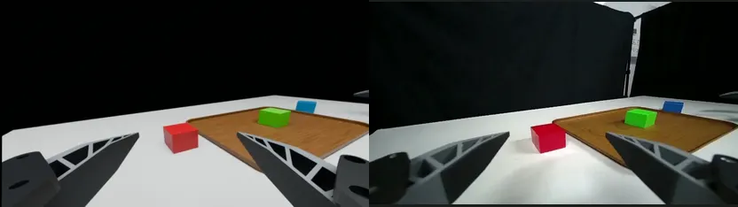

<h1 align="center">DemoFoundry</h1>

<p align="center">
  <a href="https://robbinw.github.io/DemoFoundry-Web/"></a>
  <a href="https://arxiv.org/abs/2611.34671"></a>
  <a href="https://github.com/RobbinW/DemoFoundry"></a>
  <a href="https://huggingface.co/RobbinWang123/demofoundry-h3"></a>
  <a href="https://huggingface.co/datasets/RobbinWang123/DemoFoundry"></a>
  <a href="LICENSE"></a>
</p>

<p align="center">
  <a href="https://robbinw.github.io/">Ruixiang Wang</a> · <a href="https://shinyueyao.github.io/">Xinyue Yao</a> · <a href="https://shinning-zhou.github.io/">Xuanning Zhou</a> · <a href="https://yuecideng.github.io/">Yueci Deng</a> · <a href="https://yysu.site/">Yongyi Su</a> · <a href="http://kuijia.site/">Kui Jia</a>
</p>



DemoFoundry generates action-labeled robot demonstrations for new scenes. A coding agent reconstructs the workspace and programs the task in simulation. A video renderer turns the resulting motion into photorealistic observations using a single RGB reference per camera. Robot states and actions come from the same execution.

## Release checklist

- [x] Publish a [real–proxy video dataset](https://huggingface.co/datasets/RobbinWang123/DemoFoundry).
- [x] Release the [fine-tuned video renderer weights](https://huggingface.co/RobbinWang123/demofoundry-h3).
- [x] Release a [data generation example on a novel platform](examples/marvin/).
- [ ] Release more real–proxy video pairs for training reference-to-video models, 3D VLAs, and WAMs.

## DemoFoundry Real–Proxy Dataset

Each preview pairs a real recording (left) with its synchronized simulation replay (right).

<table>
  <tr>
    <td width="50%" valign="top"><a href="assets/paired-recordings/agibot-mallet.mp4"></a><br><strong>AgiBot World</strong> · Tap wooden pegs with a mallet</td>
    <td width="50%" valign="top"><a href="assets/paired-recordings/robomind.mp4"></a><br><strong>RoboMIND</strong> · Weigh an ear of corn</td>
  </tr>
  <tr>
    <td width="50%" valign="top"><a href="assets/paired-recordings/robomind-button-handoff.mp4"></a><br><strong>RoboMIND</strong> · Pass a red button between grippers</td>
    <td width="50%" valign="top"><a href="assets/paired-recordings/rh20t.mp4"></a><br><strong>RH20T</strong> · Press a row of buttons</td>
  </tr>
</table>

<details>
<summary><strong>How we build the pairs and generate new demonstrations</strong></summary>



</details>

## Quick start

The [Marvin stacking example](examples/marvin/) takes three real camera images and a task instruction through simulation and video rendering. Run both steps from the repository root.

1. **Simulate the task.** In the [simulation environment](examples/marvin/#run-the-example), run:

   ```sh
   python examples/marvin/run.py --out runs/marvin
   ```

   This writes three proxy videos to `runs/marvin/proxy/` and synchronized joint states and actions to `runs/marvin/episode.npz`.

2. **Render the wrist view.** Switch to the [H3 environment](inference/h3/#install) and run:

   ```sh
   bash examples/marvin/render_wrist.sh runs/marvin
   ```

   H3 combines the real wrist image with the first six seconds of simulated motion and writes `runs/marvin/rendered/left-6s.mp4`. [Watch the comparison](examples/marvin/wrist-preview.mp4).

To generate a demonstration for your own setup, give the [task-programming skill](.agents/skills/demofoundry-task-programming/SKILL.md) your [workcell files](examples/marvin/#bring-your-own-workcell) and task instruction.

## Generating demonstrations in a new scene

“Place red on green with the left arm, then place blue on red with the right arm.”

<table>
  <tr>
    <th>Real first frame</th><th>Simulated scene</th><th>Task program outline</th><th width="19%">Proxy video</th><th width="19%">Rendered video</th>
  </tr>
  <tr>
    <td width="19%"></td>
    <td width="19%"></td>
    <td><pre>left.stack(red, green)
left.park()
right.stack(blue, red)</pre></td>
    <td colspan="2" width="38%"></td>
  </tr>
</table>

[View all three cameras](https://robbinw.github.io/DemoFoundry-Web/#novel-feature)

## Citation

If you find DemoFoundry useful, please cite our paper.

```bibtex
@misc{wang2026demofoundryscalablephotorealisticrobot,
  title={DemoFoundry: Toward Scalable Photorealistic Robot Data with Coding Agents and Generative Rendering},
  author={Ruixiang Wang and Xinyue Yao and Xuanning Zhou and Yueci Deng and Yongyi Su and Kui Jia},
  year={2026},
  eprint={2611.34671},
  archivePrefix={arXiv},
  primaryClass={cs.RO},
  url={https://arxiv.org/abs/2611.34671},
}
```
