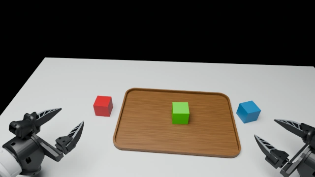

# Block stacking on Marvin M6S

Place red on green with the left arm, then blue on red with the right. The head camera supplies the initial block poses. The [task program](src/program.py) executes both grasps in simulation. Blender Cycles renders the head and wrist views.

[](stacking-proxy.mp4)

## Run the example

On Linux x86-64, install Python 3.10, CUDA 12.8-compatible drivers, Blender 4.5 LTS and FFmpeg with libx264. Put `blender` on PATH or set `BLENDER` to its executable. From the repository root:

```sh
python3.10 -m venv .venv
source .venv/bin/activate
python -m pip install torch==2.7.0 torchvision==0.22.0 --index-url https://download.pytorch.org/whl/cu128
python -m pip install -r examples/marvin/requirements.txt
python examples/marvin/run.py --out runs/marvin
```

The episode contains 37.86 seconds of motion and settling. In `runs/marvin/`:

| File | Contents |
| --- | --- |
| `proxy/{head,left,right}.mp4` | Three calibrated views at 25 fps |
| `episode.npz` | 50 Hz joint states and action targets. Use `frame_state_index` to look up each frame’s control step. |
| `metadata.json` | Joint order, gripper units and camera calibration |
| `fit/*_comparison.jpg`, `validation.json` | Real and simulated first frames, alignment scores and stack checks |

## Bring your own workcell

Copy [workcell/](workcell/) and pass its path with `--workcell`. For a new layout on Marvin, supply:

- Three synchronized RGB images in `references/` and the joint and gripper positions at capture.
- [Camera calibration](workcell/config/cameras.json) at the capture resolution. Each `T_parent_camera` maps OpenCV optical coordinates into the base or wrist flange, in metres.
- [Robot and task geometry](workcell/config/robot.json), including block sizes, support surfaces and grasp transforms. The [URDF and meshes](workcell/robot/) define the physics geometry. [scene.blend](workcell/scene.blend) contains the corresponding visuals, lights and materials.

For a fresh agent session: *Use `$demofoundry-task-programming` to run the Marvin stacking task and return its three proxy videos, synchronized actions and validation report.*

## Render the episode with H3

Activate the [H3 environment](../../inference/h3/#install). This command pairs the real wrist image with the first six seconds of `proxy/left.mp4`:

```sh
bash examples/marvin/render_wrist.sh runs/marvin
```

The result is `runs/marvin/rendered/left-6s.mp4`. [Watch the simulation and H3 output side by side](wrist-preview.mp4). For a full episode or another camera, use the [custom-view command](../../inference/h3/#render-your-own-camera-view).
