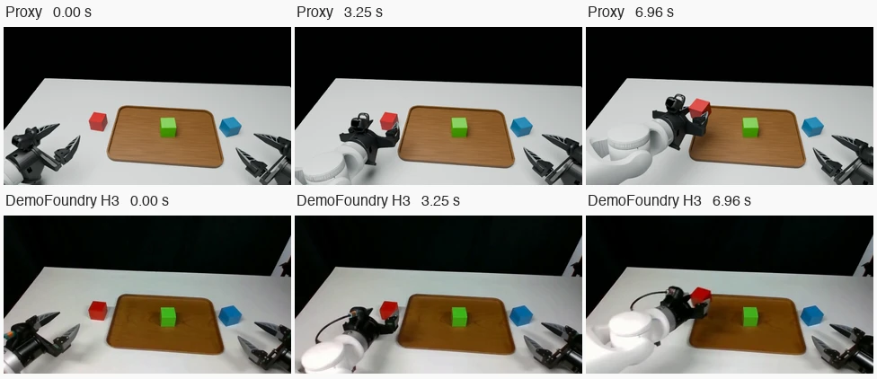

# Render robot video with MiniMax-H3

Give the renderer a proxy video and a real image from the same camera at the start of the task. The proxy supplies the motion and the image supplies the appearance.

## Install

Use a separate Python 3.10 environment on Linux with CUDA 12.8. From the repository root:

```sh
python3.10 -m venv .venv-h3
source .venv-h3/bin/activate
python -m pip install torch==2.10.0 torchvision==0.25.0 --index-url https://download.pytorch.org/whl/cu128
python -m pip install -r inference/h3/requirements.txt
```

The example uses four 80 GB A800 GPUs. Set `NPROC_PER_NODE=1` when running the example scripts on a single GPU with enough memory for the model.

## Render the example

To render the eight-second head-camera clip from the GitHub release, install GitHub CLI (`gh`) with access to the repository, then run:

```sh
bash inference/h3/run_example.sh
```

The script downloads the MiniMax-H3 backbone, the DemoFoundry LoRA and the example inputs. The result is `runs/example.mp4`.



## Render your own camera view

For the [Marvin stacking episode](../../examples/marvin/), use the matching reference and proxy under `runs/marvin/`. Select output dimensions close to the camera aspect ratio and divisible by 32.

```sh
bash inference/h3/download_weights.sh
torchrun --standalone --nproc-per-node=4 -m inference.h3.render \
  --model weights/MiniMax-H3 --adapter weights/DemoFoundry-H3.safetensors \
  --reference runs/marvin/references/left.png --proxy runs/marvin/proxy/left.mp4 \
  --size 640 352 --output runs/marvin/rendered/left.mp4
```

H3 samples the proxy at 24 fps and renders 158-frame windows with 50 denoising steps. Each window after the first uses the previous window’s final image as its reference. The shared frame appears once in the output. The first seed is 42 and increases by one per window.
